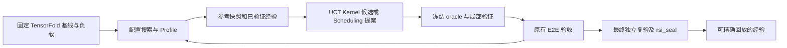

# GB10 上的参考驱动 RSI

本分支把检索参考、局部候选树、成本排序、最终复验和经验导出接入 KSEO 原有 pipeline。实测范围为 **DGX Spark GB10 / Linux aarch64 / SM121 / TensorFold Native / GLM-5.3-Flash**。运行时仍只有 Python 标准库；真实编译、部署、推理和 teacher-forced scorer 通过任务中的 adapter 执行。

当前实现已提供可运行 CPU synthetic 示例；没有据此声称 GLM 在 GB10 上获得加速。未提供真实 adapter、模型/镜像/源码身份及冻结门禁时，任务保持草稿状态。

本次检查与实测边界见 [工程验证记录](gb10-rsi-validation.md)。

## 方法来源与采用范围

| 来源 | 本工程采用 | 边界 |
| --- | --- | --- |
| [KernelForge](https://github.com/TheJoshBrod/KernelForge) | 编译/数值反馈、候选树探索、保留有效基线 | 本工程独立实现有限 UCT 搜索，没有随机 rollout；不复制其 PyTorch 模型执行框架。外部算子收益不是 TensorFold E2E 收益。 |
| [SpecPilot](https://arxiv.org/abs/2611.02501)、[代码](https://github.com/StargazerX0/SpecPilot) | 按成本上限找方向、独立最终复验、逐 token 审计、可回放经验 | 借鉴方法，不自动引入 W12、树验证或两级验证；这里的单组 GB10 AB/BA 和保守 token 审计不是论文实验的复现。 |
| [NVIDIA 设备表](https://developer.nvidia.com/cuda/gpus) | GB10 的 CC12.1 身份检查 | 编译器、算子和 dtype 支持仍需实际检查；不能把 SM120 或 SM100 支持直接当作 SM121 支持。 |
| [TensorFold #1505](https://github.com/ashhart/TensorFold/pull/1505)、[#1534](https://github.com/ashhart/TensorFold/pull/1534)、[#2219](https://github.com/ashhart/TensorFold/pull/2219) | EXL3 访存、缓存策略、GLM chunk/drafter 组合的检索种子 | 运行时重新抓取状态、head/base SHA 和文件摘录，再检查本地是否已包含、模型格式是否匹配。 |
| [vLLM #55569](https://github.com/vllm-project/vllm/issues/55569)、[#58636](https://github.com/vllm-project/vllm/issues/58636)、[#55277](https://github.com/vllm-project/vllm/pull/55277) | GB10 长上下文工作区、确定性、NoPE MLA 的实现和故障参照 | vLLM 是参考实现。当前对照基线必须是冻结的 TensorFold；参数名称和内核接口需要适配。 |

没有移植外部项目的源码。链接中的性能声明、评论和命令均不具备本任务验收或执行权限。

## 运行顺序

在 Linux / WSL 或 GB10 上执行：

```bash
python3 -m pip install -e .

# 不用 GPU、不调用 LLM，演示故意错误候选、树分支、累计补丁和完整复验
kseo rsi demo --run-dir ./runs/rsi-cpu

# 搜集指定 PR/Issue 与最新相关讨论，不启动模型
kseo rsi references --out ./inputs/gb10-references.json
# 可传自定义计划，格式见 src/kseo/data/rsi-gb10-references.json
# 配额不足时通过环境 GITHUB_TOKEN 使用已有 GitHub token；不要把 token 写进计划。

# 保留用户原来的目标、模型、基础镜像及预算，生成定向自举请求
kseo rsi prepare /path/to/brief.json \
  --references ./inputs/gb10-references.json --out ./runs/gb10-intake
```

`prepare` 复用普通 KSEO brief 格式，输出 `task.draft.json`、`readiness.json` 和 `bootstrap-request.json`。外层 coding Agent 按自举请求接通实际 TensorFold adapter，生成同目录的 `task.json`。它不会把缺失的服务器、模型和阈值补成虚构值。未知平台或源码版本由实际发现解决；用户目标仍由 brief 绑定检查。

```bash
kseo doctor ./runs/gb10-intake/task.json --brief ./runs/gb10-intake/brief.json
kseo run ./runs/gb10-intake/task.json --run-dir ./runs/gb10-run-001
kseo resume ./runs/gb10-run-001

# 只有最终 measured 复验成功的运行可导出；会重算审计并回放累计 patch
kseo rsi export-memory ./runs/gb10-run-001 --out ./knowledge/gb10-001
# 下一次 prepare 通过 --memory ./knowledge/gb10-001/memory.json 接入
```

已有完整 pipeline 合同时，可用 `kseo rsi enable task.json --references refs.json --out task-rsi.json` 派生合同。两个 task 必须同目录，以保持原 adapter/source 的相对路径语义。该命令保留原验收策略；measured 合同还必须具备下述 GB10 与最终审计字段。

GitHub 请求只读取两个允许的仓库；默认最多 12 条资料、3 个查询。快照记录来源、状态、时间、base/head SHA、文件和评论摘录及内容 hash，截断明确标记。缓存保留一小时，限流后重试可复用已取得的响应。参考快照与经验文件进入 tools manifest，运行期间改变会导致拒绝恢复。

## 搜索与成本反馈



`optimizer.rsi` 可配置 `kernel_candidates`（默认 6）、`branching`（2）、`max_depth`（3）、`exploration`（1.4）。每个 Kernel 子流程冻结一次根 oracle，全部分支验证同一组 cases。有效父节点允许继续修改；编译失败、数值错误、重复 tree 和无提案均记录。提交 System 的补丁是相对本子流程根节点的累计 diff，且源码 tree 必须与局部验证完全一致。局部最快只是进入 E2E 的候选。

每次候选调用前持久化计费；全局最多 `kernel_candidates × budget.max_trials` 次 Kernel 调用，并受总时间/GPU 小时预算约束。中断后沿用 KSEO 清理与恢复，未完成子流程从新的冻结尝试重建；历史调用已消耗的预算不会返还。`workflows/w*/search.json` 保留树、父子关系、错误摘要和局部证据。一次只在已租用的资源上顺序运行，避免 GB10 共用内存和热状态干扰。

可在标准 Profile hotspot 内增加 `cost`：

```json
{
  "measured_ms": 10,
  "bytes": 1000000000,
  "flops": 1000000000,
  "bandwidth_gbs": 200,
  "throughput_tflops": 5,
  "evidence": "示意数字；实测时填本节点校准产物与统计口径"
}
```

时间下界取 bytes/bandwidth 与 flops/throughput 的较大值，再由热点占比估计可节省比例。GB/s 和 TFLOP/s 使用十进制单位。这里的示意值不是 GB10 参数；下界比测量还慢时标记不一致并取消 headroom，不生成虚假收益。重叠时间仍遵守现有 `critical_path` / `gpu_time` 区分。

## GB10 与最终独立验收协议

measured RSI 合同固定 `context.gpu_arch=sm_121`、`backend=tensorfold-native`、`model_family=glm-5.3-flash`，并要求 `require_equivalence_rationale=true`。本版复用 KSEO 的镜像身份链：必须开启 `validation.docker_artifacts=true` 并接通 build/deploy/smoke；不是仅修改源码后继续测量旧二进制。控制器在启动基线前检查 sealed stock tree 等于冻结源码。

`validation.gb10_devices` 填真实 GPU UUID 列表，长度等于 `resources.gpu_count`。在每个节点运行 `kseo rsi probe`，preflight adapter 把结果放入 `runtime.gb10_nodes`。控制器重新检查 Linux、ARM64、GB10、CC12.1 和 UUID 集合；未知身份拒绝通过。跨节点 adapter 仍需使用现有统一资源锁与幂等 cleanup。

最终增加 `steps[].name=rsi_seal`，在 stability 之后、multi_turn/final_accuracy 之前执行；对应硬门禁是 `rsi_seal.passed == true`。它仅在最终阶段运行，原来的速度、数值、完整精度、API、稳定性和镜像身份门禁全部保留。`validation.rsi_seal` 要求：

| 字段 | 来源或含义 |
| --- | --- |
| `requests` | 至少三个 holdout 请求，逐项冻结 `id`、`prompt_sha256`、`tokens`。真实评估宜使用更充分的代表性样本；至少覆盖长输出和目标并发。 |
| `repeats` | 每请求至少 3 个成对重复，按轮次 AB/BA 交替；预热、缓存及运行形态由独立 adapter 固定。 |
| `min_gain`、`noise_fraction` | 接受阈值与实测 stock/stock 噪声；下界须超过 `min_gain + 2 × noise_fraction`。 |
| `max_logprob_gap`、`max_mismatch_excess` | 在搜索前根据 stock 浮点行为校准并冻结；不套用论文阈值。 |
| `stock_source_tree` | 原始 TensorFold 源码 Git tree，40 位 SHA。 |
| `scorer_sha256` | 独立 scorer 的代码、精确目标权重和评分配置清单 hash。 |
| `decoding` | 本版只能为 `greedy`。随机采样的等分布验证不在该协议内。 |

adapter 的标准 identity/kind envelope 之外，输出 `stock_source_tree`、`candidate_source_revision`、`pairs_file`/`pairs_file_sha256` 与 `tokens_file`/`tokens_file_sha256`。所有文件均限于当前 stage 目录。

`rsi_seal.runtime` 同样携带当前 candidate 的 artifact/deployment_id。单组 GB10 上可交替停止/重启两个已冻结容器以释放显存；保留当前最终 candidate 容器的身份，结束后让它可供后续完整精度阶段使用。预热及模型重载时间的计时范围必须在 adapter 中固定。不要把 stock 产物冒充当前 candidate。

`pairs_file` 是 JSONL，每行包含 `request_id, prompt_sha256, repeat, order, stock_tokens, candidate_tokens, stock_ms, candidate_ms`。同请求的重复先聚合，再以请求为单位 bootstrap 几何平均加速比；不把重复测量当成更多独立请求。短输出、缺轮次、不同请求或时间非正都拒绝。

`tokens_file` 每行包含 `system`（stock/candidate）、`request_id, position, prompt_sha256, prefix_sha256, scorer_sha256, token_id, argmax_id, token_logprob, argmax_logprob`。独立 scorer 在各自完整输出路径上逐位置 teacher forcing，含 reasoning tokens；不能仅检查最终答案。漏 token、重复位置、错 scorer 或非法 logprob 都拒绝。stock 或 candidate 出现超过冻结 gap 的 mismatch 直接拒绝；候选 mismatch 的 Wilson 上界不得超出 stock 上界加冻结容差。这是保守工程审计，不单独构成数学等价证明。

KSEO 不提供 OS sandbox。scorer、holdout 原文、编译/验收工具应由外部权限隔离；开发 Agent 只获得其允许查看的开发负载与诊断。`rsi_seal` 核对原始记录并重算门禁，不会凭接口名称就保证 holdout 对开发 Agent 不可见。

## 经验反馈和适用边界

运行内继续使用 `learned-experience.json`，保存 E2E 成败、参考编号及候选树位置。跨运行导出仅接受 measured + COMPLETED + 最终独立审计通过，随后从 stock 回放累计 patch 并核对最终 tree。输出包含参数、版本、组合假设、证据和未验证范围；组合收益不分摊给每个单独机制。

下一次运行仅检索模型族、引擎和硬件一致的经验，仍标为 `REVALIDATION_REQUIRED`。换权重、版本、并发、长度、编译器或节点拓扑都要重新验证。synthetic/replay、局部成功但 E2E 失败、最终复验未过的运行均不能导出成实测经验。

此升级没有自动实现 GLM 的 speculative 算法或 CUDA 内核。它提供寻找、实现和验证候选所需的自动化控制链。真实收益的判断依据始终是目标 GB10 上冻结合同的结果。
